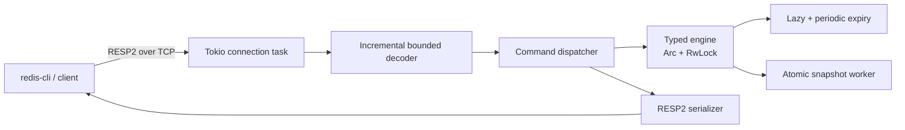

<p align="center">
  
</p>

# VeltrixDB

VeltrixDB is a from-scratch, Redis-compatible in-memory database written in
stable Rust. It owns its storage engine, RESP2 codec, asynchronous TCP server,
expiration logic, typed collections, and snapshot format—Redis is used only as
an interoperability and benchmark reference.

> **Project status:** tested systems project, not production-ready. Compatibility
> is limited to the commands in [COMPATIBILITY.md](COMPATIBILITY.md). There is no
> authentication, TLS, replication, clustering, AOF, or eviction policy.

## What works

- Incremental, bounded RESP2 parsing across fragmented and pipelined TCP frames.
- Concurrent Tokio clients with bounded connection count and controlled shutdown.
- Binary-safe strings plus hashes, lists, sets, and sorted sets.
- Lazy and periodic expiry with `SET EX`/`PX`, `TTL`, and `PTTL`.
- Versioned atomic JSON snapshots, expiry restoration, periodic saves, and a
  final controlled-shutdown save.
- A reusable async client, interactive CLI, and wire-level benchmark runner.
- Real `redis-cli 8.0.5` interoperability and restart recovery verification.

## Quick start

Requirements: Rust 1.85 or newer.

```bash
cargo build --release --workspace
target/release/veltrix-server --bind 127.0.0.1:6379
```

In another terminal, use the bundled client:

```bash
target/release/veltrix-cli --addr 127.0.0.1:6379 SET greeting hello EX 60
target/release/veltrix-cli --addr 127.0.0.1:6379 GET greeting
```

Or use an installed Redis CLI:

```bash
redis-cli -p 6379 PING
redis-cli -p 6379 HSET user:1 name Veltrix role database
redis-cli -p 6379 HGET user:1 role
redis-cli -p 6379 ZADD scores 10 alpha 20 beta
redis-cli -p 6379 ZRANGE scores 0 -1 WITHSCORES
```

The reproducible demonstration is [scripts/redis-cli-demo.sh](scripts/redis-cli-demo.sh).

## Persistence and recovery

Enable snapshots explicitly:

```bash
target/release/veltrix-server \
  --bind 127.0.0.1:6379 \
  --snapshot ./data/veltrix.snapshot \
  --snapshot-interval-ms 30000
```

The server loads an existing snapshot at startup. Saves serialize an immutable
copy outside the async I/O path, write a same-directory temporary file, `fsync`
it, atomically rename it, then synchronize the parent directory. TTL deadlines
are stored as Unix milliseconds and rebuilt against a monotonic clock.

This is snapshot durability, not an append-only log: a hard crash can lose writes
since the last completed snapshot. A controlled shutdown writes one final snapshot.

## Architecture



The shared lock is never held across `.await`. Networking is one task per
connection; snapshot encoding and filesystem I/O run via `spawn_blocking`.
See [ARCHITECTURE.md](ARCHITECTURE.md) for invariants and crate boundaries.

## Command compatibility

| Area | Supported subset |
| --- | --- |
| Connection | `PING`, `ECHO` |
| Strings/keys | `GET`, `SET [EX/PX]`, `DEL`, `EXISTS`, `TTL`, `PTTL` |
| Hashes | `HSET`, `HGET`, `HDEL`, `HLEN` |
| Lists | `LPUSH`, `RPUSH`, `LPOP`, `RPOP`, `LLEN`, `LRANGE` |
| Sets | `SADD`, `SREM`, `SISMEMBER`, `SMEMBERS`, `SCARD` |
| Sorted sets | `ZADD`, `ZREM`, `ZSCORE`, `ZRANGE [WITHSCORES]`, `ZCARD` |
| Memory | `MEMORY USAGE key` (approximate payload bytes) |

The exact option and semantic limits are documented in
[COMPATIBILITY.md](COMPATIBILITY.md). Unsupported features are not silently
advertised as compatible.

## Tests and quality gates

```bash
cargo fmt --all -- --check
cargo clippy --workspace --all-targets --all-features -- -D warnings
cargo test --workspace --all-features
cargo build --release --workspace
```

The suite covers byte-by-byte fragmented frames, pipelining, malformed input,
invalid commands, wrong types, expiration edge cases, 32 simultaneous clients,
idle-client shutdown, typed collections, atomic snapshot interruption, and a
full server snapshot/restart recovery. GitHub Actions runs the same checks in
[.github/workflows/ci.yml](.github/workflows/ci.yml).

## Measured benchmark snapshot

On 7 November 2026, the included runner was measured against Redis Open Source
8.0.5 on the same loopback host, both with persistence disabled. Five alternating
samples with 32 clients produced these medians:

| Workload | VeltrixDB | Redis 8.0.5 |
| --- | ---: | ---: |
| `PING`, 20,000 operations | 82,475 ops/s | 75,355 ops/s |
| alternating `SET`/`GET`, 20,000 operations | 50,134 ops/s | 42,107 ops/s |

The sample variability was high, so these are development-host observations,
not general performance claims. Hardware, exact raw samples, warm-up, commands,
limitations, and methodology are in [BENCHMARKING.md](BENCHMARKING.md).

## Security and release discipline

- Bind only to loopback or a trusted private network.
- Snapshot contents are unencrypted and inherit filesystem permissions.
- Protocol and connection limits mitigate resource abuse but do not create a
  secure multi-tenant boundary.
- Read [SECURITY.md](SECURITY.md) before deployment.
- Use [RELEASE_CHECKLIST.md](RELEASE_CHECKLIST.md) before tagging a release.

The phased roadmap is tracked in [IMPLEMENTATION_PLAN.md](IMPLEMENTATION_PLAN.md),
and the verified work in this repository is summarized in
[COMPLETION_REPORT.md](COMPLETION_REPORT.md).

## License

MIT. See [LICENSE](LICENSE).
